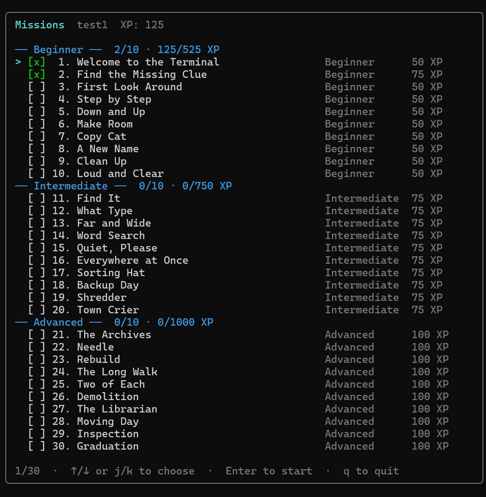
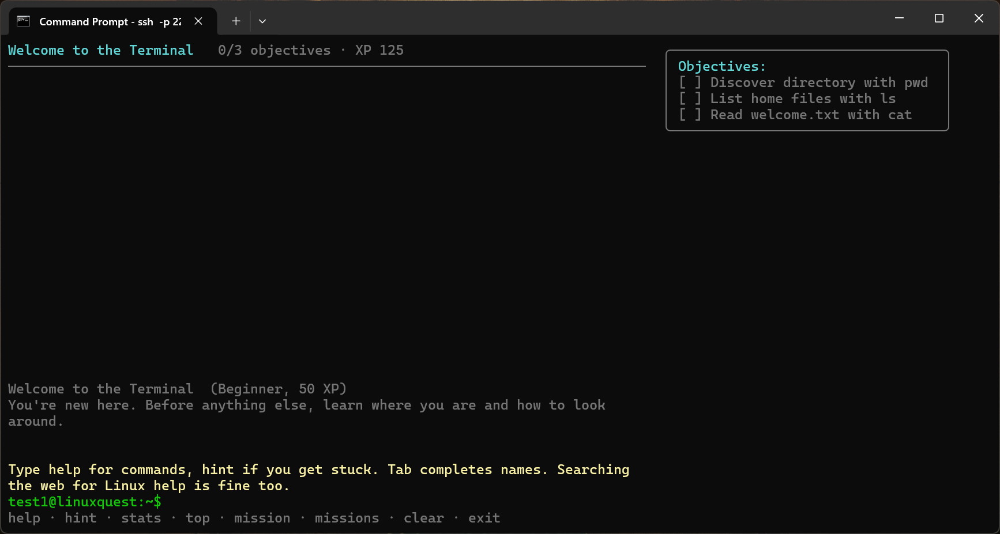
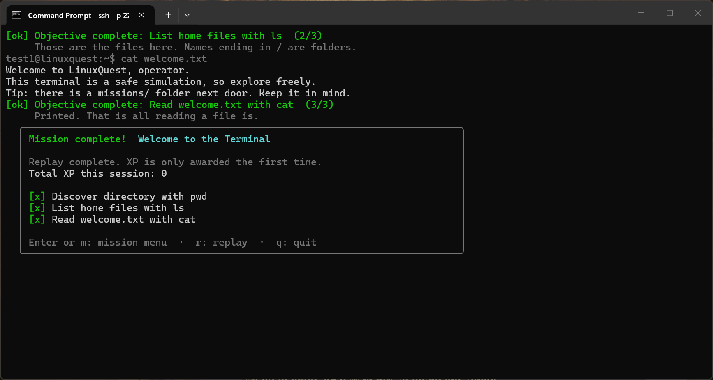

# LinuxQuest

LinuxQuest is a terminal game that teaches Linux commands. Players connect over
SSH, pick a mission, and type commands into a **simulated** Linux shell. Nothing
they type ever reaches the real server.

It ships an SSH server, a virtual filesystem, a small command simulator, a
data-driven mission engine, a Bubble Tea interface, and thirty playable
missions in three tiers of ten. The first two:

| Mission | Difficulty | XP | You practise |
|---|---|---|---|
| 1. Welcome to the Terminal | Beginner | 50 | `pwd`, `ls`, `cat` |
| 2. Find the Missing Clue | Beginner | 75 | `cd`, `cd ..`, `find`, `cat` |

## Quick start (Docker)

Requires Docker with the Compose plugin.

```bash
docker compose up -d --build     # build and start
docker compose logs -f linuxquest # view logs (Ctrl+C stops following)
docker compose ps                 # shows "healthy" once the server answers
docker compose down               # stop (the SSH host key volume is kept)
```

Then, from any machine that can reach the server:

```bash
ssh -p 2222 YOUR_NAME@YOUR_SERVER_IP
```

Login is by **SSH key only — there are no passwords**. If you do not have a
key yet, make one (once per device):

```bash
ssh-keygen -t ed25519 -C "you@linuxquest"   # press Enter three times
```

then connect with it:

```bash
ssh -p 2222 -i ~/.ssh/id_ed25519 YOUR_NAME@YOUR_SERVER_IP
```

Pick any username (letters, digits, `.` `_` `-`). The **first** time you
connect, that username becomes your account and your key is registered to it.
The very first account ever created is automatically an admin.
The first time you connect, OpenSSH also shows the server's host-key
fingerprint and asks you to trust it — compare it with the fingerprint on the
help page below. That is normal.

> **New here?** Open `http://YOUR_SERVER_IP:8080` in a browser: step-by-step
> key setup for Windows, macOS, Linux, and Android, with this server's live
> fingerprint and port filled in.

To change the port or other settings, copy `.env.example` to `.env` and edit it
(no source changes are required). `docker compose down -v` also deletes the host
key volume, so players would then see a "host key changed" warning.

## Run locally without Docker

Requires Go 1.22 or newer.

```bash
make deps    # runs `go mod tidy`; creates go.sum on first use (commit it)
make test    # go test ./...
make run     # starts on 0.0.0.0:2222 (override with LINUXQUEST_PORT / LINUXQUEST_HOST)
```

In another terminal (after `ssh-keygen -t ed25519` if you have no key yet):
`ssh -p 2222 -i ~/.ssh/id_ed25519 you@localhost`. The host key is created at
`data/ssh_host_ed25519` and accounts at `data/linuxquest.db` on first start.
The help page runs at `http://localhost:8080` (`LINUXQUEST_WEB_PORT`; `0` disables it).

> **go.sum:** the repository ships `go.mod` without a `go.sum`. The first
> `make deps` (or `go mod tidy`) downloads the dependencies and writes it. Commit
> the generated `go.sum` so later builds are checksum-verified.

## Configuration

All settings are environment variables.

| Variable | Default | Meaning |
|---|---|---|
| `LINUXQUEST_PORT` | `2222` | TCP port to listen on (Compose publishes the same port on the host) |
| `LINUXQUEST_HOST` | `0.0.0.0` | Interface to listen on inside the process |
| `LINUXQUEST_HOST_KEY` | `data/ssh_host_ed25519` (`/data/ssh_host_ed25519` in Docker) | Host key path. Generated (Ed25519, mode 0600) if missing |
| `LINUXQUEST_MAX_SESSIONS` | `100` | Concurrent sessions; extra players get a "server is full" message. `0` = unlimited |
| `LINUXQUEST_IDLE_TIMEOUT_MIN` | `15` | Disconnect idle players after N minutes. `0` = never |
| `LINUXQUEST_MAX_SESSION_MIN` | `120` | Hard cap on session length in minutes. `0` = none |
| `LINUXQUEST_DB` | `data/linuxquest.db` (`/data/linuxquest.db` in Docker) | SQLite account database (users, progress, stats). Created automatically |
| `LINUXQUEST_ADMINS` | *(empty)* | Comma-separated usernames granted admin (e.g. `LINUXQUEST_ADMINS=teacher,ops`). The first registered account is admin either way |
| `LINUXQUEST_WEB_PORT` | `8080` | Login-help web page (key setup guide with the live fingerprint). `0` disables it |
| `LINUXQUEST_BIND` | `0.0.0.0` | Compose only: host interface to publish on (`127.0.0.1` keeps it private) |

The host key and the account database live in the `linuxquest-data` Docker
volume, so both survive container restarts and rebuilds. To use your own key,
place it at the `LINUXQUEST_HOST_KEY` path before starting.

## How to play

Thirty missions in three tiers of ten — Beginner (50 XP), Intermediate
(75 XP), Advanced (100 XP) — from `pwd` to multi-step investigations where
you build, search, and clean up. Number keys jump to the first nine missions;
the menu scrolls for the rest.

1. Press **Enter** on the welcome screen.
2. Choose a mission with **↑/↓ + Enter**, or press a number for the first nine.
   Start at the top: later missions assume earlier skills.
3. Read the objectives, then type commands at the prompt.

Each objective shows `[ok] Objective complete` when you finish it. Finish all of
them to see the completion screen, where **Enter/m** returns to the menu,
**r** replays the mission, and **q** quits.

| Command | What it does |
|---|---|
| `help` | List supported commands |
| `mission` | Show the current mission and which objectives are done |
| `missions` | Go back to the mission menu |
| `hint` | Next hint for your current objective. Repeat for more detail |
| `keys` | List your registered SSH keys |
| `keyadd <key>` | Register another key (second device): paste its `.pub` line |
| `keyrm <fingerprint>` | Remove one of your keys (never the last one) |
| `stats` | Your lifetime stats (XP, missions, commands, hints, logins) |
| `top` | XP leaderboard across all players |
| `admin` | Admin console (admin accounts only): totals, plus `users`, `inspect <name>`, `reset <name>`, `ban`/`unban <name>`, `promote`/`demote <name>` |
| `clear` | Clear the screen (also **Ctrl+L**) |
| `exit` | End the session and show your summary (also **Ctrl+D** on an empty line) |
| `pwd` | Print the current directory |
| `ls [path]` | List a directory (folders end in `/`) |
| `cd [path]` | Change directory. `cd ..` goes up, `cd` or `cd ~` goes home |
| `cat <file>...` | Print files |
| `find [path] -name <pattern> [-type f\|d]` | Search by name; `*` and `?` work inside quotes or not |
| `mkdir <dir>` | Create a directory (parents included, like `mkdir -p`) |
| `touch <file>` | Create an empty file |
| `rm [-r] [-f] <path>...` | Delete (`-r` for directories, `-f` ignores missing files) |
| `cp [-r] <src> <dst>` | Copy (`-r` for directories) |
| `mv <src> <dst>` | Move or rename |
| `echo <text>` | Print text (no redirection yet) |
| `grep [-i] [-r] <pattern> [path...]` | Search file contents (`-r` descends into directories) |

Keys: **↑/↓** recall history, **←/→/Home/End** edit the line, **Ctrl+C** clears
the current line (or quits when the line is empty). **Tab** completes the
command or path you are typing (directories earn a `/`); with several matches
it extends the shared part, or lists them on a second press.

The interface follows your terminal size: the mission menu scrolls (ready for
dozens of missions), boxes shrink to fit narrow windows, and long input such
as a pasted key scrolls horizontally with markers so the cursor never
gets lost.

Rules worth knowing:

- Objectives are judged by what your commands *did*, not by exact text. For
  example `cat secrets/clue.txt`, `cat ~/secrets/clue.txt`, and
  `cd secrets` then `cat clue.txt` all read the clue.
- Stuck? Use `hint` first. Looking up Linux commands online is allowed too:
  reading docs is part of the job.
- In mission 2, "go back home" only counts after you have entered `documents`.
- Replaying a mission resets its files and directory. **XP is awarded only the
  first time** you ever complete a mission, across all sessions, so replays
  cannot be farmed.
- Progress is saved to your account: XP, completed missions, commands, hints,
  and logins survive disconnects and restarts. Type `stats` any time to see
  your totals.

## Project layout

```text
cmd/linuxquest/        main: config, startup, graceful shutdown, -healthcheck probe
internal/sshserver/    Wish SSH server, public-key auth + self-registration, per-connection sessions
internal/terminal/     Bubble Tea UI: screens, input line, history, styling
internal/session/      per-player game state: built-in commands, hints, XP, summary, stats/leaderboard/admin
internal/simulator/    command parser + pwd/ls/cd/cat/find against the virtual FS
internal/filesystem/   in-memory filesystem and safe path resolution
internal/missions/     mission loader/validator and objective evaluation
internal/progress/     session XP and completions (restored from storage at login)
internal/store/        SQLite key accounts, mission progress, usage stats, leaderboard
internal/webhelp/      login-help web page (key setup guide, live fingerprint)
missions/              mission definitions (embedded JSON)
tests/                 end-to-end tests over a real SSH connection
```

Responsibilities are separated so new commands and missions slot in without
touching the SSH layer: the simulator knows nothing about missions, and
missions only look at the *results* of commands.

### Adding a mission

Drop a new JSON file in `missions/` (copy an existing one). It declares the
story, XP, starting files, and objectives. Supported objective kinds:

| Kind | Completed when |
|---|---|
| `ran` | the named `command` ran successfully |
| `listed` | the directory at `path` was listed |
| `read` | the file at `path` was read with `cat` |
| `entered` | `cd` succeeded and the working directory is now `path` |
| `found` | `find` printed `path` as a match |
| `created` | `path` was created by `mkdir`, `touch`, `cp`, or `mv` |
| `removed` | `path` was removed by `rm` or moved away by `mv` |
| `grepped` | `grep` printed a matching line from `path` |

Use `requires` to make an objective wait for others, and `hints` for
progressive hints (vague first, specific last). The loader rejects malformed
missions at startup. Adding a *command* means a new function in
`internal/simulator` that records its effects in `Result`.

## Security model

- **No real shell, ever.** Player input is parsed into words and run by a Go
  simulator over an in-memory filesystem. The code never calls `os/exec`, never
  invokes a shell, and never touches the host filesystem or environment for
  player actions.
- **Safe paths.** Every path is normalised lexically against a virtual root, so
  `..` at `/` stays at `/`. NUL bytes and over-long paths are rejected.
- **No shell syntax.** Unquoted `; & | < > \`` are rejected rather than
  interpreted. There is no variable expansion, globbing, or substitution.
  Control characters (such as terminal escape sequences) are stripped from input.
- **Interactive terminals only.** Connections without a PTY (including
  `ssh host command`) are refused. Port forwarding, SFTP, and other subsystems
  are not enabled.
- **SSH keys only, no passwords.** The first connection for a username
  creates the account owning the presented key; afterwards one of its
  registered keys is required. There is nothing to phish, brute-force, or
  leak from the server: only public keys are stored. Usernames are limited to
  1-32 safe characters, and rejected logins never say which half mismatched.
  Keys are added/removed in-game with `keyadd`/`keyrm` (the last key cannot be
  removed, so nobody locks themselves out). The first account ever created is
  admin; further admins come from `LINUXQUEST_ADMINS`. Admins manage players from
  inside the game (`admin users`, `admin inspect`, `admin reset`, `admin ban` /
  `unban`, `admin promote` / `demote`); bans and role changes apply to online
  players immediately, while a progress reset takes full effect on their next
  login. You cannot ban or demote yourself. If you want a fully
  private server, restrict access at the network level too.
- **Container hardening.** Multi-stage build; final image is distroless with no
  shell; runs as non-root (UID 65532); read-only root filesystem; all Linux
  capabilities dropped; `no-new-privileges`; memory and process limits. No host
  directories are mounted: only a named volume for the host key. Only the SSH
  port is published.
- **No secrets in the repo or image.** The host key is generated at first start
  and stored in the volume. It is never logged.
- **Logging.** The server logs connects and disconnects (address, terminal type,
  client version, duration). It does **not** log keystrokes or commands.
- **Resource limits.** Maximum concurrent sessions, idle timeout, maximum
  session length, bounded input length (256 characters), and bounded scrollback
  and history per session.

### VPS deployment and firewall notes

- **Port choice.** Your server's own admin SSH normally uses port 22. Keep
  LinuxQuest on another port (default 2222) and leave admin SSH alone. If you
  want players on port 22, move your admin sshd to a different port **first**
  and confirm you can still log in, or you will lock yourself out.
- **Open only that port**, for example with UFW:
  ```bash
  sudo ufw allow 2222/tcp
  sudo ufw status
  ```
  Cloud providers often have a separate network firewall or security group that
  also needs a rule for this port.
- **Connection flooding.** The app caps concurrent sessions but does not rate-limit
  new connections per IP. For a public server, add limits at the firewall
  (for example `ufw limit 2222/tcp`, or nftables/iptables rate rules) and/or run
  fail2ban-style tooling against the logs.
- **Private use.** Set `LINUXQUEST_BIND=127.0.0.1` and reach it through a VPN or
  an SSH tunnel instead of exposing it publicly.
- **Docker and UFW.** Docker publishes ports by editing iptables directly, which
  can bypass UFW rules. Check from outside the machine that only the ports you
  intend are reachable, or bind to `127.0.0.1` and put a reverse proxy or
  firewall rule in front.
- **Keep the host key.** Back up the `linuxquest-data` volume if you do not want
  players to see a changed-host-key warning after rebuilding the server.

## Testing

```bash
go test ./...          # or: make test
go test -race ./...    # with the race detector (needs a C compiler)
go vet ./...
```

The suite covers: path resolution and escape attempts, `pwd`/`ls`/`cd`/`cat`/`find`
(including errors), unsupported commands and shell-syntax rejection, malformed
input, mission loading and validation, objective tracking, alternative command
sequences, completion and XP, replays, hints, session isolation, the Bubble Tea
screens and input handling, and end-to-end play over a real SSH connection
(both missions, simultaneous sessions, host-isolation, non-interactive
rejection, abrupt disconnects, session limit, host-key persistence).

### Manual SSH test

1. Start the server (`docker compose up -d --build` or `make run`).
2. Make a throwaway key (`ssh-keygen -t ed25519 -f /tmp/lq-test -N ""`) and connect: `ssh -p 2222 -i /tmp/lq-test tester@localhost`.
   Confirm the welcome screen says the account was created.
3. Press Enter, then `1`. Run `pwd`, `ls`, `cat welcome.txt`. Confirm each
   objective is announced and the completion screen shows **+50 XP**.
4. Press `m`, then `2`. Run `hint` (the hint must not give the answer away), then
   `cd documents`, `cd ..`, `find . -name clue.txt`, `cat secrets/clue.txt`.
   Confirm **+75 XP** and **Total XP: 125**.
5. Try to break out: `cat /etc/passwd`, `cd ../../..`, `ls /`, `whoami`,
   `ls; id`, `cat $(id)`. You should only see simulated errors, never real host data.
6. Open a second terminal and connect with a *different* username. Confirm its directory and XP are
   independent of the first session.
7. Reconnect with the *first* username and password. Confirm XP and the
   completed mission survived the disconnect (`stats` shows lifetime totals).
8. Press `q` to see the session summary, then disconnect with any key.
9. Restart the server and reconnect. The host-key fingerprint should be unchanged, and accounts still work.

## Troubleshooting

| Symptom | Likely cause and fix |
|---|---|
| `Connection refused` | Server not running (`docker compose ps`, `docker compose logs`), wrong port, or the firewall/security group blocks it |
| `Connection timed out` | Firewall or cloud security group is dropping the port |
| `REMOTE HOST IDENTIFICATION HAS CHANGED` | The host key changed (volume deleted or key replaced). Run `ssh-keygen -R "[HOST]:2222"` and reconnect |
| `Requires an active PTY` | Non-interactive use such as `ssh host cmd`. Connect with plain `ssh -p 2222 YOU@HOST` |
| `Permission denied (publickey)` | Wrong key for that username, or no key offered (`-i` flag missing). Usernames are 1-32 safe chars |
| `LinuxQuest is full right now` | Hit `LINUXQUEST_MAX_SESSIONS`. Raise it or retry |
| Garbled box characters or colours | Use a UTF-8-capable terminal with a font that includes box-drawing characters |
| Layout looks cramped | Enlarge the window; the UI adapts to the terminal size (about 80x24 works well) |
| Host key volume permission errors | Make sure the volume is writable by UID 65532. A fresh named volume works automatically |
| `missing go.sum entry` | Run `go mod tidy` (or `make deps`) once |
| Healthcheck "unhealthy" | `docker compose logs linuxquest`. The probe is `linuxquest -healthcheck`, a TCP connect that expects an `SSH-` banner on `LINUXQUEST_PORT` |

## Known limitations

- Progress is saved per account in SQLite, but there is no backup story beyond the Docker volume yet.
- No password fallback: lose all your keys and the account is unrecoverable (admins cannot log in as you). Register a second key with `keyadd` while you still can.
- Commands keep deliberately small option support (`ls` takes no flags, `find`
  supports `-name` and `-type`). Pipes, redirects, globbing, and variables are
  not supported, and deleting a mission file can only be undone by replaying
  the mission.
- No per-IP connection rate limiting inside the app (see firewall notes).
- Anyone holding a key can self-register under a fresh username (by design, like a public game server). There is no per-IP rate limiting inside the app (see firewall notes).
- The healthcheck's TCP probe may add an occasional handshake-EOF line to the logs.


## Demp

### Mission select


### Playing a mission


### Mission complete

